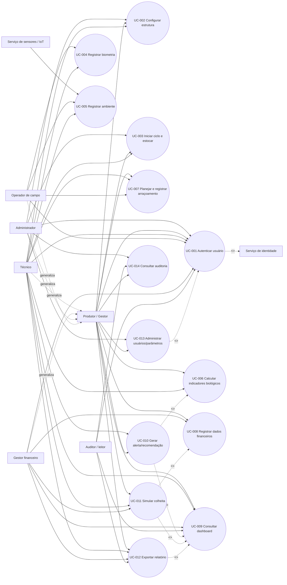
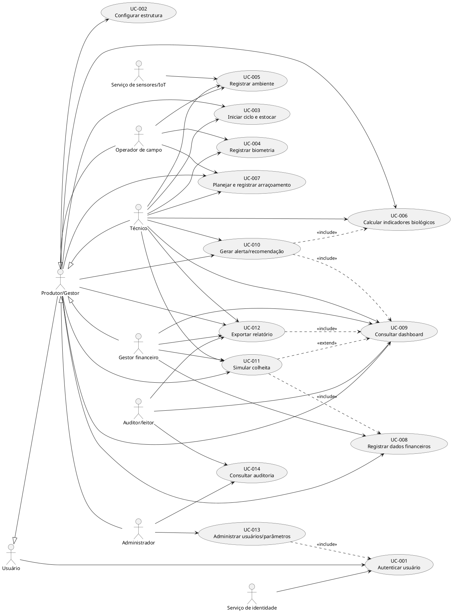

# Documento de Requisitos de Software

## Sistema de Apoio à Decisão para Carcinicultura

- **Versão:** 1.0 — proposta inicial
- **Data:** 08/10/2026
- **Status:** Baseline inicial para validação com stakeholders
- **Classificação:** Documento de requisitos funcionais, não funcionais e de negócio

---

## 1. Resumo executivo

Este documento especifica, do zero, os requisitos de um Sistema de Apoio à Decisão (SAD) para a gestão de cultivos de camarão em viveiros. O sistema deverá centralizar dados produtivos, biológicos, ambientais e financeiros; calcular indicadores; apresentar dashboards; registrar o manejo alimentar; apoiar a identificação de desvios; e oferecer recomendações para decisões de produção e comercialização.

O domínio foi inferido a partir dos materiais fornecidos. Os documentos descrevem a aplicação de conceitos de Agricultura 4.0 e Aquicultura de Precisão à carcinicultura, com uso de indicadores como densidade de estocagem, biometria, biomassa, fator de conversão alimentar (FCA), receita bruta, custos operacionais, lucro operacional, margem operacional, ROA e ROE.

O núcleo do produto é um SAD web, com front-end separado do back-end, API REST e processamento analítico. A stack confirmada nos materiais inclui Next.js, TypeScript, Python, FastAPI, Pydantic, NumPy, Pandas, SciPy e Recharts. Banco de dados, provedor de nuvem, mecanismo de identidade, integração real com sensores e metas operacionais ainda não foram definidos.

### 1.1 Classificação das informações

| Marcador | Significado |
| :--- | :--- |
| **Confirmado** | Informação explicitamente presente nos materiais analisados ou decorrente diretamente de uma fórmula/descrição documentada. |
| **Suposição** | Decisão provisória necessária para completar a especificação, aguardando validação. |
| **Proposta** | Recomendação de produto ou arquitetura feita neste documento, não apresentada como regra já aprovada. |
| **Em aberto** | Informação ausente que requer decisão do negócio, da operação ou da arquitetura. |

---

## 2. Fontes analisadas e interpretação

Foram analisados quatro PDFs fornecidos pelo solicitante:

1. **Dados essenciais BIOLOGICO.pdf** — fundamentos do SAD, indicadores zootécnicos, biometria, biomassa, FCA, tabela alimentar e uso das sobras de ração como sinal complementar.
2. **Dados essenciais FINANCEIRO.pdf** — receita bruta, custos operacionais, lucro operacional, margem operacional, ROA, ROE e integração de indicadores.
3. **Tecnologias utilizadas no projeto.pdf** — separação front-end/back-end, arquitetura em camadas, Next.js, TypeScript, Python, NumPy, Pandas, SciPy, Recharts, REST, FastAPI e Pydantic.
4. **ilovepdf_merged.pdf** — versão consolidada que repete o conteúdo biológico e financeiro dos documentos anteriores; não introduziu requisitos de negócio adicionais.

Os PDFs foram tratados como material de referência. Eventuais afirmações acadêmicas, citações bibliográficas e justificativas tecnológicas não foram convertidas automaticamente em regras de negócio. Quando uma regra operacional não estava definida, ela foi marcada como proposta ou pergunta em aberto.

---

## 3. Visão geral do sistema

### 3.1 Nome de trabalho
**Suposição S-001:** utilizar o nome de trabalho **SAD Carcinicultura** até que o nome oficial do produto seja informado.

### 3.2 Descrição
O SAD Carcinicultura será uma aplicação web para apoiar a gestão de fazendas e ciclos de cultivo de camarão. A solução deverá permitir:
- cadastrar empreendimento, viveiros e ciclos produtivos;
- registrar estocagem, biometrias, arraçoamentos, sobras, condições ambientais, custos e vendas;
- calcular indicadores biológicos, produtivos e financeiros;
- correlacionar dados de diferentes naturezas;
- apresentar dashboards e séries históricas;
- gerar alertas e recomendações explicáveis;
- apoiar simulações de colheita e comercialização, caso essa capacidade seja aprovada;
- manter segurança, permissões, auditoria e rastreabilidade dos dados.

### 3.3 Problema e oportunidade
O produtor precisa tomar decisões com base em dados de viveiros, alimentação, crescimento, qualidade da água, custos e preços. Esses dados podem estar dispersos, ser registrados manualmente ou ser coletados com diferentes frequências e níveis de confiabilidade. A ausência de integração dificulta:
- detectar subalimentação ou superalimentação;
- acompanhar crescimento, sobrevivência e biomassa;
- compreender o efeito das decisões produtivas nos custos e na rentabilidade;
- identificar desvios ambientais e produtivos em tempo hábil;
- comparar ciclos e viveiros;
- documentar por que uma recomendação foi apresentada.

A oportunidade é transformar dados operacionais em informação gerencial integrada, sem tratar um indicador isolado — por exemplo, sobras de ração — como diagnóstico conclusivo.

### 3.4 Objetivo principal
Disponibilizar uma plataforma confiável e explicável para monitorar, analisar e apoiar decisões de manejo e gestão econômica da carcinicultura.

### 3.5 Contexto de negócio
O sistema apoia a operação de cultivos em viveiros escavados ou estruturas equivalentes, em ciclos nos quais camarões são estocados, alimentados, monitorados por biometrias e condições ambientais, e posteriormente colhidos e comercializados. O sistema não substitui a avaliação técnica do produtor, do responsável técnico ou do especialista em aquicultura.

### 3.6 Público-alvo
- produtores e proprietários de fazendas de camarão;
- gestores de produção;
- técnicos e responsáveis pelo acompanhamento zootécnico;
- operadores de campo responsáveis por alimentação e medições;
- gestores financeiros ou administrativos;
- administradores da plataforma.

---

## 4. Objetivos do produto

| ID | Objetivo | Resultado esperado |
| :--- | :--- | :--- |
| **O-001** | Centralizar os dados do cultivo | Dados biológicos, ambientais, operacionais e financeiros disponíveis em uma base integrada. |
| **O-002** | Melhorar o manejo alimentar | Recomendação de arraçoamento baseada em biomassa, peso médio, tabela alimentar e contexto observado. |
| **O-003** | Acompanhar o desempenho zootécnico | Evolução de densidade, peso, sobrevivência, biomassa e FCA por viveiro e ciclo. |
| **O-004** | Integrar produção e finanças | Receita, custos, lucro, margem, ROA e ROE analisados com o contexto produtivo. |
| **O-005** | Apoiar decisões e antecipar desvios | Dashboards, alertas e recomendações com indicação de dados usados e limitações. |
| **O-006** | Garantir confiança e rastreabilidade | Permissões, validações, logs, histórico de alterações e resultados reproduzíveis. |
| **O-007** | Permitir evolução tecnológica | API desacoplada, arquitetura em camadas e possibilidade de integração futura com sensores e outros clientes. |

---

## 5. Escopo do sistema

### 5.1 Dentro do escopo
1. Gestão de organizações, propriedades, viveiros e ciclos de cultivo.
2. Cadastro de estocagem, área útil, quantidade inicial e taxa de sobrevivência estimada.
3. Registro de biometrias e cálculo de peso médio.
4. Registro de condições ambientais, manualmente ou por integração aprovada.
5. Registro de alimentação planejada, fornecida e sobra observada.
6. Cálculo de densidade, população estimada, biomassa, FCA e demais indicadores aprovados.
7. Cadastro de custos operacionais e informações de comercialização.
8. Cálculo de receita bruta, custo operacional, lucro operacional, margem, ROA e ROE, quando houver dados suficientes.
9. Dashboard integrado por empreendimento, ciclo e viveiro.
10. Alertas e recomendações explicáveis, com parâmetros configuráveis.
11. Relatórios e exportação de dados autorizados.
12. Autenticação, autorização, auditoria e rastreabilidade.
13. API REST para comunicação entre a interface e os serviços de back-end.

### 5.2 Fora do escopo inicial
- acionamento automático de aeradores, bombas, alimentadores ou outros equipamentos;
- diagnóstico veterinário ou sanitário conclusivo;
- substituição da decisão do responsável técnico;
- contabilidade fiscal completa, emissão de documentos fiscais ou folha de pagamento;
- compra, venda ou logística de insumos como processo transacional;
- marketplace ou integração automática com bolsas de preços;
- previsão meteorológica própria;
- controle físico de acesso à fazenda;
- manutenção de sensores e equipamentos de campo;
- treinamento de modelos de inteligência artificial sem dataset e validação aprovados;
- garantia de decisão ótima quando os dados de entrada forem incompletos ou de baixa qualidade.

---

## 6. Stakeholders

| Stakeholder | Interesse | Responsabilidades/impacto |
| :--- | :--- | :--- |
| **Proprietário/produtor** | Rentabilidade, produtividade e sustentabilidade | Define objetivos, acompanha indicadores e toma decisões. |
| **Gestor de produção** | Controle do ciclo e dos viveiros | Registra ou valida manejo, acompanha alertas e compara desempenho. |
| **Técnico/responsável técnico** | Qualidade zootécnica e ambiental | Valida parâmetros, interpreta recomendações e configura referências técnicas. |
| **Operador de campo** | Registro simples e rápido | Coleta dados de biometria, alimentação e ambiente. |
| **Gestor financeiro** | Custos, receita e retorno | Mantém informações econômicas e analisa resultados. |
| **Administrador do sistema** | Segurança e governança | Gerencia usuários, permissões, configurações e auditoria. |
| **Equipe de desenvolvimento** | Entrega e evolução do produto | Implementa, testa, monitora e mantém o sistema. |
| **Fornecedores de sensores** | Disponibilidade de dados de campo | Podem fornecer medições mediante integração aprovada. |
| **Órgãos reguladores/auditores** | Conformidade e evidências | Podem demandar histórico e controles, quando aplicável. |

---

## 7. Perfis de usuários e atores

### 7.1 Perfis

| ID | Perfil | Permissões típicas |
| :--- | :--- | :--- |
| **PERF-001** | Administrador da plataforma | Gerenciar usuários, organizações, parâmetros globais, integrações e auditoria. |
| **PERF-002** | Proprietário/gestor | Consultar todos os dados autorizados, configurar operação, validar lançamentos e decisões. |
| **PERF-003** | Técnico | Registrar/validar dados zootécnicos e ambientais, configurar referências e analisar recomendações. |
| **PERF-004** | Operador de campo | Registrar tarefas e medições do escopo autorizado; sem acesso amplo a dados financeiros. |
| **PERF-005** | Gestor financeiro | Registrar custos, ativos, patrimônio, vendas e consultar indicadores financeiros. |
| **PERF-006** | Auditor/leitor | Consultar dados e trilhas autorizadas, sem alterar registros. |

### 7.2 Atores do sistema

| Ator | Tipo | Descrição |
| :--- | :--- | :--- |
| **Usuário autenticado** | Primário | Pessoa que acessa o sistema com uma conta autorizada. |
| **Produtor/Gestor** | Especialização | Consulta e administra o desempenho da operação. |
| **Técnico** | Especialização | Valida dados e interpreta indicadores/recomendações. |
| **Operador de campo** | Especialização | Alimenta dados de campo. |
| **Gestor financeiro** | Especialização | Alimenta e analisa dados econômicos. |
| **Administrador** | Especialização | Administra segurança, usuários e configurações. |
| **Serviço de sensores/IoT** | Secundário, proposto | Fonte externa de dados ambientais ou operacionais, se integrada. |
| **Serviço de identidade** | Secundário, proposto | Provedor externo de autenticação, se adotado. |
| **Serviço de exportação** | Secundário | Componente interno ou serviço responsável por gerar arquivos. |

**Suposição S-002:** os perfis representam papéis distintos, mas uma mesma pessoa poderá acumular mais de um papel dentro de uma organização.

---

## 8. Dados, entidades e unidades

### 8.1 Entidades principais

| Entidade | Atributos mínimos propostos |
| :--- | :--- |
| **Organização** | id, nome, identificador, status, preferências e moeda. |
| **Usuário** | id, nome, e-mail/login, status, organização, perfil, último acesso. |
| **Propriedade/fazenda** | id, organização, nome, localização, área e dados de referência. |
| **Viveiro** | id, propriedade, nome/código, área útil em m², capacidade, status. |
| **Ciclo de cultivo** | id, viveiro, espécie/linhagem, data de início, data de encerramento, status. |
| **Estocagem** | ciclo, data, quantidade inicial, quantidade de pós-larvas, origem, observações. |
| **Biometria** | ciclo/viveiro, data, tamanho da amostra, peso total da amostra, peso médio, responsável. |
| **Condição ambiental** | ciclo/viveiro, data/hora, parâmetro, valor, unidade, origem, qualidade. |
| **Arraçoamento** | ciclo/viveiro, data/hora, quantidade planejada, quantidade fornecida, frequência, operador. |
| **Sobra de ração** | arraçoamento, data/hora da observação, quantidade/nível, método, observação. |
| **Tabela alimentar** | versão, faixa de peso, consumo, taxa, origem, vigência, ativo. |
| **Indicador calculado** | tipo, ciclo/viveiro, período, valor, unidade, versão da fórmula, entradas usadas. |
| **Custo** | ciclo, categoria, data, valor, fornecedor, documento/referência, observação. |
| **Ativo/patrimônio** | organização/ciclo, tipo, valor, período de referência. |
| **Comercialização** | ciclo, data, biomassa/quantidade, preço, faixa de gramatura, comprador. |
| **Recomendação/alerta** | tipo, severidade, data, entradas, regra/modelo, mensagem, status. |
| **Auditoria** | ator, ação, entidade, identificador, data/hora, antes/depois, origem. |

### 8.2 Unidades e precisão

**Proposta P-001:** armazenar valores em unidades canônicas e converter apenas na apresentação:
- **área:** m²;
- **população:** quantidade de indivíduos;
- **peso médio:** g por indivíduo;
- **biomassa:** kg;
- **ração:** g ou kg, com unidade explícita por registro;
- **densidade:** indivíduos/m²;
- **taxas e margens:** percentual;
- **FCA:** razão adimensional;
- **valores financeiros:** moeda da organização, com código ISO 4217;
- **data/hora:** UTC no armazenamento e fuso configurado na apresentação.

O sistema deverá preservar precisão suficiente para evitar arredondamentos acumulados e informar a regra de arredondamento aplicada na apresentação.

---

## 9. Requisitos funcionais

Os requisitos abaixo formam a baseline proposta. O campo **Status** identifica se o requisito foi confirmado pelos materiais, deduzido como necessidade direta ou proposto para fechar uma lacuna.

| ID | Requisito | Status | MoSCoW | Critério de aceitação |
| :--- | :--- | :--- | :--- | :--- |
| **RF-001** | O sistema deve autenticar usuários antes de permitir acesso a dados protegidos. | Proposto | Must | Usuário válido acessa somente após autenticação; credencial inválida é rejeitada e registrada. |
| **RF-002** | O sistema deve aplicar permissões por organização, propriedade, viveiro e perfil. | Proposto | Must | Usuário não consegue consultar ou alterar recurso fora de seu escopo autorizado. |
| **RF-003** | O sistema deve permitir cadastrar e manter organizações, propriedades e viveiros. | Necessário | Must | É possível criar, editar, inativar e consultar um viveiro com área útil e identificação únicas dentro do escopo. |
| **RF-004** | O sistema deve permitir criar, iniciar, pausar, encerrar e consultar ciclos de cultivo. | Necessário | Must | Um ciclo possui viveiro, data de início e status; encerramento exige confirmação e preserva o histórico. |
| **RF-005** | O sistema deve registrar estocagem, quantidade inicial de pós-larvas e dados de origem. | Confirmado | Must | Ao salvar uma estocagem, a quantidade e a data ficam vinculadas ao ciclo e entram nos cálculos autorizados. |
| **RF-006** | O sistema deve calcular e exibir a densidade de estocagem por ciclo/viveiro. | Confirmado | Must | O valor corresponde a N/A, com N e A identificados e unidade indivíduos/m². |
| **RF-007** | O sistema deve registrar biometrias periódicas, amostra e peso médio. | Confirmado | Must | O registro exige data, tamanho da amostra e dados de peso; o peso médio calculado é exibido. |
| **RF-008** | O sistema deve registrar condições ambientais por parâmetro, valor, unidade, data/hora e origem. | Confirmado como necessidade; campos pendentes | Must | O registro identifica parâmetro e unidade; valores inválidos ou fora da faixa configurada são sinalizados. |
| **RF-009** | O sistema deve calcular população sobrevivente estimada e biomassa total. | Confirmado | Must | O sistema calcula população estimada conforme a taxa de sobrevivência vigente e biomassa pela fórmula documentada. |
| **RF-010** | O sistema deve manter versões da tabela alimentar e permitir selecionar a referência aplicável ao ciclo. | Confirmado | Must | Alterar uma tabela não modifica resultados históricos sem nova versão/reprocessamento explícito. |
| **RF-011** | O sistema deve fornecer recomendação de quantidade de ração com base na biomassa, peso médio, tabela e contexto disponível. | Confirmado como objetivo; regra final pendente | Must | A recomendação mostra valor, unidade, entradas usadas, versão da tabela e aviso quando faltar contexto. |
| **RF-012** | O sistema deve registrar quantidade de ração planejada, fornecida, frequência, operador e observações. | Necessário | Must | É possível consultar o histórico por data, ciclo e viveiro; alterações ficam auditadas. |
| **RF-013** | O sistema deve registrar sobras ou nível de consumo após o arraçoamento. | Confirmado | Must | O lançamento identifica o arraçoamento relacionado e não permite concluir automaticamente mortalidade somente pela sobra. |
| **RF-014** | O sistema deve calcular FCA e disponibilizar histórico por ciclo e período. | Confirmado | Must | O sistema apresenta fórmula, entradas e período; divide por ganho de biomassa somente quando o denominador for válido. |
| **RF-015** | O sistema deve registrar custos operacionais por categoria e período. | Confirmado | Must | Custos de pós-larvas, ração, energia, mão de obra, manutenção e outros podem ser discriminados. |
| **RF-016** | O sistema deve registrar biomassa comercializada, preço, faixa de gramatura e data da venda. | Necessário; faixa de gramatura é proposta | Must | O lançamento é vinculado ao ciclo e permite recalcular a receita correspondente. |
| **RF-017** | O sistema deve calcular receita bruta e custo operacional total. | Confirmado | Must | Receita e custo são calculados com as entradas registradas, moeda e período explícitos. |
| **RF-018** | O sistema deve calcular lucro operacional e margem operacional. | Confirmado | Must | Lucro = receita bruta - custos operacionais; margem = lucro/receita × 100 quando receita diferente de zero. |
| **RF-019** | O sistema deve registrar os dados necessários para ROA e ROE e calcular esses indicadores quando disponíveis. | Confirmado; dados faltantes | Should | O resultado identifica lucro líquido, ativo total e patrimônio líquido usados e informa indisponibilidade quando faltar entrada. |
| **RF-020** | O sistema deve apresentar dashboard integrado biológico, ambiental, produtivo e financeiro. | Confirmado como objetivo | Must | O usuário filtra por organização, propriedade, viveiro, ciclo e período e visualiza indicadores e tendências. |
| **RF-021** | O sistema deve gerar alertas de qualidade de dados, desvios ou condições configuradas. | Proposto | Should | Cada alerta informa regra, severidade, data, dados usados e status de tratamento. |
| **RF-022** | O sistema deve apresentar recomendações explicáveis para manejo e gestão. | Confirmado como objetivo; lógica final pendente | Should | Toda recomendação mostra justificativa, entradas, limitações e responsável pela decisão final. |
| **RF-023** | O sistema deve permitir simular cenários de colheita, preço e custos. | Proposto a partir da referência ao ponto ótimo | Could | Usuário cria cenário sem alterar o realizado e obtém resultados comparáveis e identificados como simulação. |
| **RF-024** | O sistema deve permitir analisar ou estimar ponto ótimo de colheita conforme algoritmo aprovado. | Proposto; definição ausente | Could | O resultado exibe objetivo, restrições, dados usados, versão do algoritmo e sensibilidade quando aplicável. |
| **RF-025** | O sistema deve permitir exportar relatórios e dados autorizados em formato definido. | Necessário | Should | Exportação respeita permissões, filtros e período; o arquivo informa data de geração e origem dos dados. |
| **RF-026** | O sistema deve disponibilizar API REST para recursos autorizados. | Confirmado | Must | Endpoints documentados aceitam e retornam JSON, aplicam autenticação, validação e códigos HTTP coerentes. |
| **RF-027** | O sistema deve registrar logs de auditoria de ações relevantes. | Proposto | Must | Criar, alterar, excluir/inativar, autenticar, exportar e alterar permissões geram eventos consultáveis. |
| **RF-028** | O sistema deve permitir importar dados de sensores ou arquivos quando a integração for aprovada. | Proposto | Could | Importação valida schema, unidade, data/hora, origem e duplicidade; erros são apresentados sem descartar silenciosamente dados. |
| **RF-029** | O sistema deve permitir configurar parâmetros, faixas e referências por organização, com controle de versão. | Proposto | Should | Alterações exigem permissão e preservam o valor anterior e a data de vigência. |
| **RF-030** | O sistema deve impedir ou sinalizar cálculos baseados em dados incompletos, inconsistentes ou obsoletos. | Necessário | Must | O usuário vê o motivo da indisponibilidade e os campos necessários para completar o indicador. |

### 9.1 Regras de cálculo

As fórmulas abaixo foram transcritas ou normalizadas a partir dos PDFs. A validação do responsável técnico é obrigatória antes de serem usadas em produção.

| Indicador | Fórmula | Observações |
| :--- | :--- | :--- |
| **Densidade de estocagem** | $D = N / A$ | $N$ = quantidade de pós-larvas; $A$ = área útil em m². |
| **Biomassa total** | $\text{Biomassa (kg)} = \frac{\text{sobreviventes} \times \text{peso médio (g)}}{1.000}$ | Sobreviventes é estimado; peso médio vem da biometria selecionada. |
| **FCA** | $\text{FCA} = \frac{\text{ração fornecida}}{\text{ganho de biomassa}}$ | Não calcular quando o ganho de biomassa for zero, negativo ou indisponível sem tratamento aprovado. |
| **Receita bruta** | $\text{Receita bruta} = \text{biomassa comercializada} \times \text{preço de venda}$ | Unidade da biomassa e preço devem ser compatíveis. |
| **Custo operacional total** | $CO_t = \sum C_i$ | Deve discriminar componentes e período. |
| **Lucro operacional** | $\text{Lucro operacional} = \text{Receita bruta} - \text{Custos operacionais}$ | Não equivale necessariamente a lucro líquido. |
| **Margem operacional** | $\text{Margem} = \frac{\text{Lucro operacional}}{\text{Receita bruta}} \times 100$ | Não calcular quando a receita bruta for zero. |
| **ROA** | $\text{ROA} = \frac{\text{Lucro líquido}}{\text{Ativo total}} \times 100$ | Depende de lucro líquido e ativo total válidos. |
| **ROE** | $\text{ROE} = \frac{\text{Lucro líquido}}{\text{Patrimônio líquido}} \times 100$ | Depende de lucro líquido e patrimônio líquido válidos. |

---

## 10. Requisitos não funcionais

| ID | Requisito | Status | MoSCoW | Critério de aceitação |
| :--- | :--- | :--- | :--- | :--- |
| **RNF-001** | A API e o front-end devem separar apresentação, regras de negócio, processamento analítico e persistência. | Confirmado | Must | Alterações de interface não exigem duplicar regras de cálculo no cliente. |
| **RNF-002** | A API deve usar REST, JSON e documentação OpenAPI. | Confirmado | Must | Todos os endpoints publicados possuem contrato, exemplos, erros e autenticação documentados. |
| **RNF-003** | O sistema deve proteger dados em trânsito com HTTPS/TLS. | Proposto | Must | A aplicação não aceita credenciais ou dados protegidos em conexão não segura. |
| **RNF-004** | Senhas, tokens e segredos não devem ser armazenados em texto puro. | Proposto | Must | Revisão de segurança não encontra credenciais expostas em banco, logs ou código. |
| **RNF-005** | O sistema deve aplicar menor privilégio e isolamento por organização. | Proposto | Must | Testes de autorização cobrem leitura, criação, alteração, exportação e administração. |
| **RNF-006** | O sistema deve atender à LGPD e às políticas de privacidade aplicáveis. | Proposto/regulatório | Must | Há base legal, finalidade, retenção, controle de acesso e procedimento de atendimento definidos antes da produção. |
| **RNF-007** | Os resultados calculados devem ser reproduzíveis a partir dos dados, versões de fórmulas e parâmetros registrados. | Necessário | Must | Reprocessar o mesmo conjunto versionado produz o mesmo resultado, salvo mudança explicitamente versionada. |
| **RNF-008** | O sistema deve validar tipos, unidades, intervalos e relações entre dados antes de persistir. | Necessário | Must | Dados inválidos são rejeitados ou encaminhados para revisão com mensagem acionável. |
| **RNF-009** | Consultas comuns do dashboard devem responder em até 3 s no percentil 95 sob a carga de referência. | Proposto | Should | Teste de carga aprovado com volume e concorrência definidos no plano de desempenho. |
| **RNF-010** | Cálculos analíticos assíncronos devem informar status, conclusão e falha. | Proposto | Should | O usuário não fica sem resposta nem recebe resultado parcial como definitivo. |
| **RNF-011** | O serviço deve ter disponibilidade mensal alvo de 99,5%, exceto manutenção comunicada. | Proposto | Should | Monitoramento mensal mede disponibilidade e incidentes conforme SLA aprovado. |
| **RNF-012** | A arquitetura deve permitir crescimento de organizações, ciclos, medições e consultas sem reescrita estrutural. | Confirmado como objetivo | Should | Teste de crescimento não degrada além dos limites aprovados. |
| **RNF-013** | A interface deve ser responsiva para desktop, tablet e telas móveis compatíveis. | Confirmado como necessidade de front-end | Must | Fluxos de campo principais funcionam em viewport móvel sem perda de dados. |
| **RNF-014** | A interface deve seguir práticas de acessibilidade, preferencialmente WCAG 2.1 AA. | Proposto | Should | Auditoria encontra navegação por teclado, contraste, foco e rótulos adequados. |
| **RNF-015** | O sistema deve usar português do Brasil, moeda e fuso configuráveis por organização. | Suposição | Should | Datas, números, percentuais e valores são exibidos conforme a configuração. |
| **RNF-016** | O sistema deve manter backups, recuperação e retenção definidos antes da entrada em produção. | Proposto | Must | Teste periódico restaura uma cópia e comprova RPO/RTO aprovados. |
| **RNF-017** | Logs técnicos não devem expor senha, token, dados pessoais desnecessários ou segredos. | Proposto | Must | Revisão automatizada e manual não identificam dados sensíveis indevidos. |
| **RNF-018** | O código e a API devem possuir testes automatizados para fórmulas, permissões e validações críticas. | Proposto | Must | Pipeline bloqueia publicação se cobertura e testes de aceite definidos falharem. |
| **RNF-019** | O sistema deve ser observável por métricas, logs estruturados, rastreamento de erros e alertas operacionais. | Proposto | Should | Falhas de API, jobs e integrações podem ser diagnosticadas com correlação de requisição. |
| **RNF-020** | A precisão e o arredondamento dos indicadores devem ser definidos por indicador e não somente pela tela. | Necessário | Must | Resultados persistidos ou recalculáveis não apresentam divergência injustificada entre telas e exportações. |

---

## 11. Regras de negócio

| ID | Regra | Status |
| :--- | :--- | :--- |
| **RN-001** | Todo dado operacional deve pertencer a uma organização e, quando aplicável, a uma propriedade, viveiro e ciclo. | Proposta necessária |
| **RN-002** | Um ciclo deve ter um viveiro e uma data de início antes de receber medições produtivas. | Proposta necessária |
| **RN-003** | A densidade de estocagem é calculada pela quantidade inicial dividida pela área útil do viveiro. | Confirmada |
| **RN-004** | A biometria deve ser tratada como amostra representativa; o sistema deve registrar tamanho da amostra e responsável. | Confirmada como prática; validação operacional pendente |
| **RN-005** | O intervalo recomendado entre biometrias é de 7 a 15 dias; isso é recomendação e não bloqueio automático, salvo decisão do técnico. | Confirmada como recomendação |
| **RN-006** | A população sobrevivente é uma estimativa e não uma contagem exata de indivíduos. | Confirmada |
| **RN-007** | A biomassa usa a população estimada e o peso médio da biometria selecionada. | Confirmada |
| **RN-008** | O FCA deve usar ração fornecida e ganho de biomassa do período definido. | Confirmada; período exato em aberto |
| **RN-009** | A tabela alimentar é referência técnica e pode ser ajustada pelas condições do viveiro; não deve ser tratada como regra fixa sem aprovação. | Confirmada |
| **RN-010** | A tabela inicial baseada em Clifford possui faixas documentadas de 2 g a 20 g; faixas adicionais dependem de aprovação. | Confirmada |
| **RN-011** | Sobras de ração devem ser interpretadas junto com indicadores biológicos e ambientais; não permitem concluir mortalidade isoladamente. | Confirmada |
| **RN-012** | Toda recomendação deve indicar que é apoio à decisão e não diagnóstico ou ordem automática de manejo. | Proposta necessária |
| **RN-013** | Receita bruta, custo, lucro e margens devem informar período, unidade e moeda. | Proposta necessária |
| **RN-014** | ROA e ROE somente podem ser exibidos como calculados quando seus insumos estiverem disponíveis e temporalmente compatíveis. | Proposta necessária |
| **RN-015** | Indicador sem dados suficientes deve ser marcado como indisponível, com indicação das entradas ausentes; não deve ser preenchido silenciosamente com zero. | Proposta necessária |
| **RN-016** | Dados corrigidos devem preservar o valor anterior, o autor, a data/hora, o motivo e a versão do cálculo afetada. | Proposta necessária |
| **RN-017** | Uma tabela, fórmula ou parâmetro alterado não deve reescrever silenciosamente resultados históricos. | Proposta necessária |
| **RN-018** | Alertas ambientais somente podem ser ativados após definição do parâmetro, faixa, unidade, severidade e fonte de referência. | Em aberto/proposta |
| **RN-019** | O preço de venda pode variar por faixa de gramatura; a forma de cadastro e a função de otimização ainda precisam ser validadas. | Parcialmente confirmada |
| **RN-020** | Quando o denominador de uma fórmula for zero ou inválido, o sistema deve exibir condição não calculável e orientar a correção. | Proposta necessária |

---

## 12. Pré-condições e pós-condições

### 12.1 Pré-condições gerais
- organização e usuário autorizados devem existir;
- o usuário deve estar autenticado para acessar dados protegidos;
- o viveiro deve estar cadastrado para registrar ciclo ou medição;
- o ciclo deve estar aberto para receber dados operacionais;
- campos obrigatórios, unidades e datas devem ser válidos;
- para indicadores, as entradas mínimas e suas versões devem estar disponíveis;
- para integração externa, credenciais, contrato e mapeamento de dados devem estar configurados.

### 12.2 Pós-condições gerais
- dados válidos são persistidos com autoria e data/hora;
- cálculo ou recomendação registra entradas, fórmula/modelo e versão;
- alteração relevante gera auditoria;
- falha de validação não cria registro parcial;
- usuário recebe confirmação, resultado ou mensagem de correção;
- dados exportados mantêm filtro, unidade, período e origem.

---

## 13. Fluxos principais, alternativos e de exceção

### 13.1 Fluxo principal de monitoramento
1. Usuário autentica.
2. Seleciona organização, propriedade, viveiro, ciclo e período.
3. Sistema recupera dados produtivos, biológicos, ambientais e financeiros autorizados.
4. Sistema valida completude, unidade, origem e atualidade.
5. Sistema calcula ou recupera indicadores versionados.
6. Sistema apresenta cards, gráficos, tendências, alertas e recomendações explicáveis.
7. Usuário registra uma decisão, corrige dados, exporta um relatório ou apenas consulta.

### 13.2 Fluxos alternativos
- **FA-001 — Dados ambientais parciais:** o dashboard exibe os indicadores disponíveis e marca os demais como incompletos, sem bloquear a consulta geral.
- **FA-002 — Entrada manual:** o operador registra valores de campo, selecionando origem manual e método de medição.
- **FA-003 — Entrada por integração:** o serviço externo envia dados; o sistema valida schema, unidade, data/hora e duplicidade antes de persistir.
- **FA-004 — Correção de registro:** usuário autorizado altera o dado; o sistema preserva o anterior e reprocessa apenas o que estiver configurado para reprocessamento.
- **FA-005 — Simulação:** usuário copia dados do realizado para um cenário, altera preço, custo ou data e compara o resultado sem alterar o histórico.

### 13.3 Fluxos de exceção
- **FE-001 — Credencial inválida ou sessão expirada:** negar operação e registrar tentativa relevante.
- **FE-002 — Permissão insuficiente:** negar acesso sem revelar dados protegidos.
- **FE-003 — Fórmula não calculável:** informar denominador zero, entrada ausente ou unidade incompatível.
- **FE-004 — Dado fora da faixa:** bloquear ou encaminhar para revisão conforme parâmetro configurado; nunca descartar silenciosamente.
- **FE-005 — Falha de integração:** manter status de erro, registrar payload seguro e permitir reprocessamento controlado.
- **FE-006 — Conflito de atualização:** informar que o registro foi alterado por outro usuário e exigir revisão.
- **FE-007 — Indisponibilidade de serviço:** preservar entrada local apenas se o modo offline for aprovado; caso contrário, informar que o registro não foi salvo.

---

## 14. Casos de uso detalhados

### UC-001 — Autenticar usuário
- **Objetivo:** permitir acesso seguro ao sistema.
- **Ator principal:** Usuário autenticado.
- **Atores secundários:** Serviço de identidade (proposto).
- **Pré-condições:** conta ativa e método de autenticação configurado.
- **Gatilho:** usuário informa credenciais ou inicia login federado.
- **Fluxo principal:** validar identidade; criar sessão/token; carregar organização e permissões; registrar acesso.
- **Fluxos alternativos:** recuperação de acesso; segundo fator, se habilitado; seleção de organização quando o usuário tiver mais de uma.
- **Fluxos de exceção:** credencial inválida; conta bloqueada; serviço de identidade indisponível; sessão expirada.
- **Pós-condições:** sessão autenticada e escopo de acesso definido.
- **Regras relacionadas:** RN-001, RN-012, RN-016.
- **Requisitos relacionados:** RF-001, RF-002, RF-027, RNF-003, RNF-004, RNF-005.
- **Critérios de aceitação:** acesso válido permite somente recursos autorizados; tentativa inválida não revela qual campo falhou e fica sujeita à política de segurança.

### UC-002 — Configurar organização, propriedade e viveiro
- **Objetivo:** criar a estrutura operacional que receberá os dados.
- **Ator principal:** Produtor/Gestor.
- **Atores secundários:** Administrador.
- **Pré-condições:** usuário autorizado e organização selecionada.
- **Gatilho:** usuário acessa o cadastro de estrutura.
- **Fluxo principal:** informar propriedade; cadastrar viveiro; informar código, área útil e status; validar duplicidade; salvar.
- **Fluxos alternativos:** editar cadastro; inativar viveiro sem apagar histórico; cadastrar vários viveiros.
- **Fluxos de exceção:** área inválida; código duplicado; usuário sem permissão.
- **Pós-condições:** propriedade/viveiro disponível para ciclos e medições.
- **Regras relacionadas:** RN-001, RN-002, RN-020.
- **Requisitos relacionados:** RF-002, RF-003, RF-027, RF-030.
- **Critérios de aceitação:** não é possível iniciar um ciclo sem viveiro válido; inativar não remove dados históricos.

### UC-003 — Iniciar ciclo e registrar estocagem
- **Objetivo:** formalizar o início do cultivo e estabelecer a população inicial.
- **Ator principal:** Produtor/Gestor ou Técnico.
- **Atores secundários:** Operador de campo.
- **Pré-condições:** viveiro ativo, área útil válida e usuário autorizado.
- **Gatilho:** operação de povoamento.
- **Fluxo principal:** criar ciclo; informar data, espécie/linhagem, quantidade de pós-larvas e origem; validar; calcular densidade; confirmar.
- **Fluxos alternativos:** registrar mais de um lote de estocagem; corrigir quantidade mediante justificativa.
- **Fluxos de exceção:** quantidade negativa/zero; ciclo concorrente no mesmo viveiro; área ausente.
- **Pós-condições:** ciclo aberto com população inicial, densidade e trilha de auditoria.
- **Regras relacionadas:** RN-001, RN-002, RN-003, RN-016.
- **Requisitos relacionados:** RF-004, RF-005, RF-006, RF-027, RF-030.
- **Critérios de aceitação:** densidade exibida como N/A; dados da estocagem ficam vinculados ao ciclo e não podem ser confundidos com outro viveiro.

### UC-004 — Registrar biometria
- **Objetivo:** atualizar o acompanhamento do crescimento e o peso médio.
- **Ator principal:** Técnico ou Operador de campo.
- **Atores secundários:** Produtor/Gestor.
- **Pré-condições:** ciclo aberto e instrumento/método disponível.
- **Gatilho:** realização de coleta periódica.
- **Fluxo principal:** selecionar ciclo; informar data, tamanho da amostra e pesos; calcular peso médio; revisar; salvar.
- **Fluxos alternativos:** informar diretamente peso médio quando o método aprovado permitir; anexar observação ou evidência.
- **Fluxos de exceção:** amostra inválida; data incoerente; peso fora de faixa; tentativa fora do intervalo recomendado.
- **Pós-condições:** biometria persistida e disponível para indicadores e recomendações.
- **Regras relacionadas:** RN-004, RN-005, RN-007, RN-016.
- **Requisitos relacionados:** RF-007, RF-009, RF-010, RF-011, RF-027, RF-030, RNF-007, RNF-020.
- **Critérios de aceitação:** o sistema mostra peso médio, amostra, responsável, data e eventual aviso de intervalo; a biometria usada em cálculo é identificável.

### UC-005 — Registrar condição ambiental
- **Objetivo:** registrar parâmetros ambientais úteis ao acompanhamento do cultivo.
- **Ator principal:** Técnico ou Operador de campo.
- **Atores secundários:** Serviço de sensores/IoT, se integrado.
- **Pré-condições:** parâmetro e unidade cadastrados; ciclo ou viveiro válido.
- **Gatilho:** medição manual, importação ou recebimento de evento.
- **Fluxo principal:** selecionar parâmetro; informar valor, data/hora, unidade, método e origem; validar; salvar; avaliar faixas configuradas.
- **Fluxos alternativos:** importar lote de medições; receber várias medições de sensor; corrigir medição com justificativa.
- **Fluxos de exceção:** unidade desconhecida; valor inválido; timestamp duplicado; sensor não autorizado; falha de integração.
- **Pós-condições:** medição disponível, classificada quanto à qualidade e potencialmente relacionada a alerta/recomendação.
- **Regras relacionadas:** RN-011, RN-018, RN-020.
- **Requisitos relacionados:** RF-008, RF-021, RF-022, RF-028, RF-029, RF-030.
- **Critérios de aceitação:** cada medição possui origem, unidade e timestamp; o sistema não gera alerta de faixa sem regra configurada e versionada.

### UC-006 — Calcular indicadores biológicos
- **Objetivo:** transformar dados de estocagem, biometria e sobrevivência em indicadores zootécnicos.
- **Ator principal:** Produtor/Gestor ou Técnico.
- **Atores secundários:** Serviço analítico.
- **Pré-condições:** dados mínimos e fórmula versionada disponíveis.
- **Gatilho:** usuário solicita atualização ou o sistema executa processamento configurado.
- **Fluxo principal:** selecionar ciclo/período; validar entradas; calcular sobreviventes, biomassa, densidade e FCA; registrar versão e entradas; apresentar resultados.
- **Fluxos alternativos:** recalcular com outra biometria ou cenário; comparar ciclos/viveiros.
- **Fluxos de exceção:** denominador zero; dados conflitantes; ausência de biometria; resultado fora de limites de qualidade.
- **Pós-condições:** indicadores persistidos ou calculados sob demanda e rastreáveis.
- **Regras relacionadas:** RN-003, RN-006, RN-007, RN-008, RN-015, RN-017, RN-020.
- **Requisitos relacionados:** RF-006, RF-009, RF-014, RF-020, RF-030, RNF-007, RNF-020.
- **Critérios de aceitação:** cada indicador exibe valor, unidade, período, fórmula e entradas; dados insuficientes resultam em indisponibilidade explicada.

### UC-007 — Planejar e registrar arraçoamento
- **Objetivo:** apoiar a definição da quantidade de ração e registrar a execução.
- **Ator principal:** Técnico ou Gestor de produção.
- **Atores secundários:** Operador de campo, serviço analítico.
- **Pré-condições:** ciclo aberto, biomassa/peso/tabela disponíveis ou exceção explicitada.
- **Gatilho:** planejamento diário ou evento de manejo.
- **Fluxo principal:** selecionar viveiro/ciclo; consultar recomendação; revisar contexto ambiental e operacional; confirmar quantidade; registrar fornecimento; lançar sobra posteriormente.
- **Fluxos alternativos:** ajustar manualmente a recomendação com justificativa; dividir em tratos; usar tabela diferente aprovada.
- **Fluxos de exceção:** dados incompletos; tabela inexistente; quantidade incompatível; recomendação desatualizada.
- **Pós-condições:** plano, execução e sobra vinculados e auditados; indicadores podem ser atualizados.
- **Regras relacionadas:** RN-009, RN-010, RN-011, RN-012, RN-017.
- **Requisitos relacionados:** RF-010, RF-011, RF-012, RF-013, RF-014, RF-021, RF-022.
- **Critérios de aceitação:** a recomendação não é apresentada sem indicar a tabela, os dados de entrada e as limitações; ajuste manual exige justificativa.

### UC-008 — Registrar custos, comercialização e indicadores financeiros
- **Objetivo:** consolidar a dimensão econômica do ciclo.
- **Ator principal:** Gestor financeiro ou Produtor/Gestor.
- **Atores secundários:** Técnico.
- **Pré-condições:** organização/ciclo válidos; moeda e período definidos.
- **Gatilho:** lançamento de despesa, ativo, patrimônio ou venda.
- **Fluxo principal:** registrar categoria e valor; registrar venda e preço; relacionar ao ciclo; calcular receita, custos, lucro e margem; complementar dados de ROA/ROE; revisar.
- **Fluxos alternativos:** importar custos; registrar custo compartilhado entre ciclos; consultar indicadores sem lucro líquido/ativos completos.
- **Fluxos de exceção:** moeda incompatível; período ausente; valor inválido; denominador zero; duplicidade de lançamento.
- **Pós-condições:** lançamentos persistidos, indicadores financeiros atualizados e rastreáveis.
- **Regras relacionadas:** RN-013, RN-014, RN-015, RN-020.
- **Requisitos relacionados:** RF-015, RF-016, RF-017, RF-018, RF-019, RF-027, RF-030.
- **Critérios de aceitação:** receita, custo, lucro e margem mostram entradas e período; ROA/ROE aparecem como indisponíveis quando faltam bases válidas.

### UC-009 — Consultar dashboard integrado
- **Objetivo:** oferecer visão gerencial consolidada do cultivo.
- **Ator principal:** Produtor/Gestor.
- **Atores secundários:** Técnico, Gestor financeiro, Auditor/leitor.
- **Pré-condições:** usuário autenticado e filtros autorizados.
- **Gatilho:** usuário abre o dashboard ou altera filtros.
- **Fluxo principal:** selecionar escopo e período; sistema valida dados; carregar cards, gráficos, tendências, alertas e recomendações; permitir detalhamento.
- **Fluxos alternativos:** comparar dois ciclos; ocultar indicador financeiro; visualizar somente dados de campo.
- **Fluxos de exceção:** timeout; ausência de dados; indicador indisponível; filtro sem permissão.
- **Pós-condições:** usuário recebe visão consistente com os filtros e o nível de acesso.
- **Regras relacionadas:** RN-011, RN-012, RN-015, RN-017.
- **Requisitos relacionados:** RF-020, RF-021, RF-022, RF-025, RNF-009, RNF-013, RNF-015.
- **Critérios de aceitação:** gráficos mostram unidade, período e fonte; indicadores incompletos não são exibidos como zero; filtros não vazam dados de outra organização.

### UC-010 — Gerar e tratar alerta ou recomendação
- **Objetivo:** sinalizar desvios e apoiar a decisão com justificativa.
- **Ator principal:** Serviço analítico.
- **Atores secundários:** Técnico, Produtor/Gestor.
- **Pré-condições:** regra/modelo versionado, dados mínimos e destinatários configurados.
- **Gatilho:** nova medição, novo cálculo, execução agendada ou solicitação manual.
- **Fluxo principal:** avaliar regra; reunir entradas; calcular severidade; gerar mensagem; registrar evidências; notificar ou exibir; permitir reconhecimento e comentário.
- **Fluxos alternativos:** alerta informativo; agrupamento de alertas repetidos; suspensão temporária por manutenção.
- **Fluxos de exceção:** regra sem parâmetros; dados obsoletos; cálculo inconclusivo; canal de notificação indisponível.
- **Pós-condições:** alerta ou recomendação rastreável, com status e responsável pelo tratamento.
- **Regras relacionadas:** RN-011, RN-012, RN-018, RN-020.
- **Requisitos relacionados:** RF-021, RF-022, RF-027, RF-029, RF-030, RNF-007, RNF-019.
- **Critérios de aceitação:** mensagem identifica condição, severidade, dados usados, regra e limitações; usuário pode reconhecer sem apagar o histórico.

### UC-011 — Simular cenário e avaliar ponto de colheita
- **Objetivo:** comparar hipóteses de data, preço, biomassa e custo sem alterar o realizado.
- **Ator principal:** Produtor/Gestor ou Técnico.
- **Atores secundários:** Serviço analítico, Gestor financeiro.
- **Pré-condições:** algoritmo aprovado ou modo de simulação configurado; dados mínimos disponíveis.
- **Gatilho:** usuário solicita simulação.
- **Fluxo principal:** copiar cenário-base; informar alterações; executar cálculo; comparar receita, custo, lucro, margem e indicadores produtivos; salvar cenário opcionalmente.
- **Fluxos alternativos:** simular somente preço; simular somente data; comparar múltiplos cenários.
- **Fluxos de exceção:** objetivo não definido; dados insuficientes; algoritmo não disponível; cenário inviável.
- **Pós-condições:** resultado identificado como simulação, sem alteração dos dados oficiais.
- **Regras relacionadas:** RN-013, RN-019, RN-020.
- **Requisitos relacionados:** RF-023, RF-024, RF-020, RF-025, RNF-007.
- **Critérios de aceitação:** o sistema separa realizado de simulado, mostra parâmetros e restrições e não apresenta o cenário como recomendação definitiva sem aprovação.

### UC-012 — Exportar relatório e dados
- **Objetivo:** fornecer evidência e análise fora do sistema.
- **Ator principal:** Produtor/Gestor, Técnico, Gestor financeiro ou Auditor.
- **Atores secundários:** Serviço de exportação.
- **Pré-condições:** usuário autorizado; filtros e formato selecionados.
- **Gatilho:** usuário solicita exportação.
- **Fluxo principal:** selecionar relatório, escopo, período e formato; validar dados; gerar arquivo; registrar auditoria; disponibilizar download.
- **Fluxos alternativos:** exportar dashboard resumido; exportar dados detalhados; gerar relatório assíncrono.
- **Fluxos de exceção:** volume excedente; dados sem permissão; falha de geração; arquivo expirado.
- **Pós-condições:** arquivo acessível ao usuário autorizado, com metadados de geração.
- **Regras relacionadas:** RN-001, RN-013, RN-016.
- **Requisitos relacionados:** RF-025, RF-027, RNF-005, RNF-017.
- **Critérios de aceitação:** arquivo respeita filtros e permissões, informa unidades/moeda/período e gera evento de auditoria.

### UC-013 — Administrar usuários, perfis e parâmetros
- **Objetivo:** manter governança do acesso e das referências de cálculo.
- **Ator principal:** Administrador.
- **Atores secundários:** Produtor/Gestor.
- **Pré-condições:** administrador autenticado.
- **Gatilho:** inclusão, alteração, bloqueio de usuário ou mudança de parâmetro.
- **Fluxo principal:** selecionar entidade; conceder/remover papel ou editar parâmetro; informar vigência e motivo; validar; salvar versão; auditar.
- **Fluxos alternativos:** convite de usuário; aprovação em duas etapas; clonagem de parâmetro para nova organização.
- **Fluxos de exceção:** tentativa de retirar último administrador; parâmetro sem unidade; vigência sobreposta; usuário inexistente.
- **Pós-condições:** permissões/parâmetros atualizados sem apagar histórico.
- **Regras relacionadas:** RN-001, RN-016, RN-017, RN-018.
- **Requisitos relacionados:** RF-002, RF-029, RF-027, RNF-005, RNF-006.
- **Critérios de aceitação:** toda alteração relevante informa autor, data, motivo e versão; não é possível deixar a organização sem administrador válido.

### UC-014 — Consultar auditoria e rastreabilidade
- **Objetivo:** verificar quem fez o quê, quando e com quais dados.
- **Ator principal:** Administrador ou Auditor/leitor.
- **Atores secundários:** Produtor/Gestor, quando autorizado.
- **Pré-condições:** permissão de auditoria.
- **Gatilho:** usuário consulta trilha de um registro, indicador ou ação.
- **Fluxo principal:** informar filtros; consultar eventos; abrir detalhe antes/depois; visualizar versão da fórmula/parâmetro; exportar se permitido.
- **Fluxos alternativos:** consultar linha do tempo de um ciclo; rastrear indicador até suas entradas.
- **Fluxos de exceção:** evento retido por política; falta de permissão; correlação inexistente.
- **Pós-condições:** trilha consultada sem alteração dos eventos.
- **Regras relacionadas:** RN-016, RN-017.
- **Requisitos relacionados:** RF-027, RF-030, RNF-007, RNF-017, RNF-019.
- **Critérios de aceitação:** um indicador selecionado permite identificar dados, fórmula, parâmetros, versão e alterações relevantes que o originaram.

---

## 15. Segurança, privacidade e permissões

### 15.1 Controles mínimos
- autenticação obrigatória para dados protegidos;
- autorização por papel e escopo de organização/propriedade/viveiro;
- menor privilégio;
- segregação dos dados financeiros quando o perfil não tiver autorização;
- HTTPS/TLS;
- armazenamento seguro de senhas e tokens;
- expiração e revogação de sessões;
- proteção contra força bruta, enumeração de usuários e abuso de API;
- validação de entrada, proteção contra injeção e controle de upload;
- logs sem segredos ou dados pessoais desnecessários;
- backup criptografado e acesso restrito;
- revisão de permissões e contas inativas;
- trilha de auditoria para alterações e exportações.

### 15.2 Privacidade
**Proposta P-002:** tratar nome, e-mail, identificadores de usuário, localização, registros de operação e dados financeiros como dados potencialmente sensíveis do negócio ou dados pessoais, conforme o contexto. Definir:
- controlador e operadores;
- finalidade de cada dado;
- base legal;
- prazo de retenção;
- procedimento de correção, exportação e exclusão quando aplicável;
- acesso de terceiros e transferência internacional;
- anonimização ou pseudonimização para análises agregadas.

### 15.3 Matriz inicial de permissões

| Recurso | Administrador | Gestor | Técnico | Operador | Financeiro | Auditor |
| :--- | :---: | :---: | :---: | :---: | :---: | :---: |
| Estrutura operacional | C/E | C/E | C | C | C | L |
| Estocagem / biometria / ambiente | C/E | C/E | C/E | C | L | L |
| Arraçoamento / sobras | C/E | C/E | C/E | C | L | L |
| Custos / vendas / indicadores financeiros | C/E | C/E | L* | L | C/E | L |
| Usuários / perfis | C/E | C* | L | - | - | L |
| Parâmetros / fórmulas | C/E | C* | C* | - | - | L |
| Auditoria | C | C* | L* | - | L* | L |

> **Legenda:** **C** = Consultar; **E** = Editar; **L** = Somente leitura; **-** = Sem acesso.  
> `*` Depende do escopo e da política da organização.

---

## 16. Desempenho, disponibilidade e escalabilidade

### 16.1 Metas propostas
Como os materiais não definem números operacionais, os valores abaixo são metas iniciais para validação:
- **dashboard padrão:** p95 até 3 segundos;
- **operação de cadastro:** p95 até 2 segundos, excluindo upload e processamento assíncrono;
- **cálculo analítico sob demanda:** feedback inicial em até 2 segundos e conclusão em até 30 segundos para ciclo comum;
- **disponibilidade mensal:** 99,5%;
- **RPO alvo:** até 24 horas, a reduzir após análise do negócio;
- **RTO alvo:** até 4 horas, a validar;
- **paginação obrigatória** para históricos extensos;
- **cache controlado** para consultas repetidas, sem comprometer a consistência dos dados;
- **processamento pesado** em fila ou job assíncrono;
- possibilidade de escalar API e processamento separadamente.

### 16.2 Dependências de escala
- volume de medições por viveiro e frequência de sensores;
- quantidade de organizações e usuários simultâneos;
- retenção de séries históricas;
- frequência de reprocessamento de indicadores;
- quantidade e tamanho das exportações;
- necessidade de dados quase em tempo real;
- capacidade do banco de dados e do processamento em memória de Pandas/NumPy.

---

## 17. Auditoria, logs e rastreabilidade

O sistema deverá manter, no mínimo:
- login bem-sucedido, falho e encerrado;
- criação, alteração, inativação e exclusão lógica;
- mudança de permissões;
- criação ou alteração de ciclo, medição, alimentação, custo e venda;
- importação, falha e reprocessamento de dados externos;
- execução de cálculo, fórmula/modelo e versão usada;
- geração, reconhecimento e encerramento de alertas;
- exportações e downloads;
- alterações de tabelas, parâmetros e faixas;
- erros de API, jobs e integrações.

Cada evento deve conter ator, organização, data/hora, ação, entidade, identificador, resultado, origem e correlação. Para alterações, deve conter representação segura do estado anterior e posterior. Dados sensíveis devem ser mascarados.

---

## 18. Integrações necessárias

| Integração | Status | Objetivo | Definições pendentes |
| :--- | :--- | :--- | :--- |
| **Front-end Next.js ↔ API FastAPI** | Confirmada | Consultar e alterar recursos via REST/JSON. | Contrato de endpoints, autenticação e versionamento. |
| **Serviço de sensores/IoT** | Contexto e proposta | Receber temperatura, oxigênio dissolvido, salinidade e outros parâmetros. | Fabricantes, protocolo, frequência, conectividade, qualidade e ownership. |
| **Serviço de identidade** | Proposta | SSO, MFA ou diretório corporativo. | Provedor, protocolo, política de sessão. |
| **Importação de arquivos** | Proposta | Entrada de históricos ou medições sem integração direta. | Formatos, layout, deduplicação e validação. |
| **Exportação** | Necessária | Relatórios e dados para análise externa. | CSV/XLSX/PDF e política de retenção. |
| **Notificação** | Proposta | Avisar alertas relevantes. | E-mail, push, WhatsApp/SMS, opt-in e limites. |
| **Dados de preços de mercado** | Em aberto | Apoiar simulação/comercialização. | Fonte, licenciamento, periodicidade e confiabilidade. |

---

## 19. Arquitetura e tecnologias

### 19.1 Diretriz arquitetural
Confirmado nos materiais: arquitetura em camadas, separação front-end/back-end e API REST. Uma decomposição inicial é:
1. **Apresentação:** telas, formulários, dashboards, gráficos e experiência responsiva.
2. **API/aplicação:** autenticação, autorização, contratos, validação e orquestração.
3. **Domínio:** regras de negócio, indicadores, recomendações e estados do ciclo.
4. **Processamento analítico:** cálculos numéricos, agregações, simulações e otimização.
5. **Persistência/integrações:** banco, auditoria, arquivos, sensores e notificações.

### 19.2 Tecnologias confirmadas e localização de uso

| Tecnologia/componente | Status | Onde será utilizado |
| :--- | :--- | :--- |
| **Next.js** | Confirmado | Front-end web, roteamento, renderização e estrutura da aplicação. |
| **React** | Confirmado como base do Next.js | Componentes de interface e composição de telas. |
| **TypeScript** | Confirmado | Código do front-end, contratos e tipagem dos componentes. |
| **Recharts** | Confirmado | Gráficos de biomassa, lucro, desempenho, evolução e demais séries. |
| **Python** | Confirmado | Back-end, regras, processamento e serviços analíticos. |
| **FastAPI** | Confirmado | API REST, documentação e camada de serviços web. |
| **Pydantic** | Confirmado | Validação, serialização e contratos de entrada/saída da API. |
| **NumPy** | Confirmado | Operações numéricas e vetorização de cálculos de indicadores. |
| **Pandas** | Confirmado | Organização, transformação, filtragem e agregação de dados estruturados. |
| **SciPy** | Confirmado | Métodos científicos, cálculos especializados e possível otimização. |
| **REST/HTTP/JSON** | Confirmado | Comunicação entre front-end, back-end e futuras integrações. |
| **OpenAPI** | Confirmado por geração/documentação do FastAPI | Contrato e documentação da API. |
| **Arquitetura em camadas** | Confirmado | Organização estrutural do software. |

### 19.3 Tecnologias ainda não confirmadas

| Componente | Recomendação inicial | Situação |
| :--- | :--- | :--- |
| **Banco de dados relacional** | PostgreSQL | Proposta; escolher após volume, hospedagem e requisitos de séries temporais. |
| **Cache/fila** | Redis ou serviço gerenciado equivalente | Proposta; necessário somente se jobs, cache ou integrações justificarem. |
| **Autenticação** | OIDC/OAuth2 ou JWT com provedor gerenciado | Proposta; validar governança e operação. |
| **Hospedagem** | Nuvem compatível com containers e banco gerenciado | Em aberto; o PDF menciona nuvem conceitualmente, mas não define provedor. |
| **Observabilidade** | OpenTelemetry e agregador de logs/métricas | Proposta. |
| **CI/CD** | Pipeline com testes, análise estática e promoção controlada | Proposta. |
| **Integração IoT** | API, MQTT ou arquivo, conforme fornecedor | Em aberto. |

*Nenhum componente não confirmado deve ser tratado como decisão final de arquitetura sem validação técnica e de custos.*

---

## 20. Riscos, dependências e restrições

| ID | Tipo | Risco/dependência/restrição | Mitigação |
| :--- | :--- | :--- | :--- |
| **R-001** | Risco | Dados de campo podem ser incompletos, atrasados ou inconsistentes. | Validação, qualidade/origem, status de confiança e cálculo com indisponibilidade explícita. |
| **R-002** | Risco | Conectividade rural pode limitar sensores e uso em tempo real. | Entrada manual, fila de sincronização ou modo offline somente após estudo. |
| **R-003** | Risco | Sobras de ração podem ser interpretadas como mortalidade. | Exibir contexto e proibir diagnóstico isolado. |
| **R-004** | Risco | Fórmulas e faixas podem variar conforme técnico, espécie ou manejo. | Versionamento por organização/ciclo e validação de responsável técnico. |
| **R-005** | Risco | ROA/ROE podem usar conceitos financeiros não disponíveis na operação. | Definir plano de contas, período e origem dos dados antes de liberar como KPI oficial. |
| **R-006** | Risco | Otimização de colheita pode sugerir falsa precisão. | Exibir premissas, restrições, sensibilidade e caráter de simulação. |
| **R-007** | Dependência | Integração de sensores depende de fornecedor, protocolo e conectividade. | Contrato de integração e fallback manual. |
| **R-008** | Dependência | Disponibilidade e segurança dependem do provedor de infraestrutura. | SLA, backup, monitoramento e plano de continuidade. |
| **R-009** | Restrição | A stack tecnológica está parcialmente definida pelos materiais. | Preservar tecnologias confirmadas e registrar novas decisões. |
| **R-010** | Restrição | Não há prazo, orçamento, equipe ou metas de volume informados. | Planejar MVP após respostas às perguntas em aberto. |
| **R-011** | Risco | Dados pessoais e financeiros exigem governança e conformidade. | DPIA/avaliação de privacidade, RBAC, logs e retenção. |
| **R-012** | Risco | Uso de bibliotecas em memória pode limitar grandes volumes. | Medir volume; particionar, agregar ou adotar processamento distribuído quando necessário. |

---

## 21. Suposições adotadas

1. **S-001:** o nome de trabalho é SAD Carcinicultura.
2. **S-002:** haverá organizações com propriedades e viveiros, e os usuários serão isolados por organização.
3. **S-003:** o sistema será inicialmente web responsivo.
4. **S-004:** os dados serão armazenados com histórico, sem exclusão física de registros relevantes.
5. **S-005:** entrada manual será necessária mesmo que sensores sejam integrados no futuro.
6. **S-006:** dados de sobrevivência serão inicialmente informados ou configurados pelo usuário/técnico; o método de inferência automática ainda não está aprovado.
7. **S-007:** a tabela alimentar documentada será cadastrada como referência inicial, com versionamento e possibilidade de ajuste.
8. **S-008:** recomendações não terão poder de comando automático sobre equipamentos.
9. **S-009:** português do Brasil será o idioma inicial; fuso e moeda serão configuráveis.
10. **S-010:** um usuário poderá acumular perfis, desde que a política de segregação seja respeitada.
11. **S-011:** indicadores sem entradas suficientes serão marcados como indisponíveis, não como zero.
12. **S-012:** a versão inicial priorizará operação manual e integração por API/arquivo; sensores em tempo real dependerão de definição de fornecedor.

---

## 22. Inconsistências, ambiguidades e perguntas em aberto

### 22.1 Inconsistências ou limitações documentais
- O nome do sistema, problema, objetivo formal, público, prazo e orçamento não foram informados no formulário inicial; foram inferidos dos PDFs.
- O PDF consolidado repete trechos dos PDFs biológico e financeiro; não foi tratado como uma terceira fonte independente.
- Os materiais citam monitoramento ambiental, IoT, nuvem e Big Data em termos conceituais, mas não definem sensores, protocolos, dados ou implantação efetiva.
- O ponto ótimo de colheita e as descontinuidades de preço são mencionados na descrição de Recharts, mas objetivo, fórmula, restrições e fontes de preço não estão especificados.
- A lógica de sobrevivência estimada é descrita conceitualmente, mas não há método operacional aprovado para calcular a taxa.
- Há indicação de que as tabelas alimentares devem ser ajustadas ao ambiente, mas não há regra, limiar ou autoridade para esse ajuste.
- ROA e ROE dependem de lucro líquido, ativo total e patrimônio líquido, enquanto os indicadores financeiros detalhados também enfatizam lucro operacional; é necessário definir qual visão será oficial para cada painel.

### 22.2 Perguntas em aberto
1. Qual é o nome oficial, marca e escopo institucional do sistema?
2. O sistema atenderá uma única fazenda ou múltiplas organizações/tenants?
3. Quais parâmetros ambientais serão obrigatórios: temperatura, oxigênio dissolvido, salinidade, pH, amônia, nitrito, transparência ou outros?
4. Quais são as faixas, limites, severidades e referências técnicas de cada parâmetro?
5. Os dados ambientais serão manuais, por sensores, por arquivo ou combinação dos três?
6. Quais fabricantes, protocolos e frequências de sensores serão suportados?
7. Qual é o método aprovado para estimar sobrevivência e mortalidade?
8. O intervalo de 7–15 dias para biometria será apenas recomendação ou haverá alerta/bloqueio?
9. A tabela de Clifford será usada sem alteração, parametrizada ou substituída por tabela da fazenda?
10. Como fatores ambientais alterarão a recomendação de ração?
11. O sistema deverá dividir a ração entre quantos tratos e em quais horários?
12. Como serão registradas sobras: quantidade, percentual, classificação visual ou escala padronizada?
13. Qual é o período do FCA: diário, entre biometrias, mensal ou ciclo completo?
14. Como custos compartilhados serão rateados entre ciclos e viveiros?
15. Qual definição de lucro líquido será adotada para ROA/ROE?
16. Qual é a fonte do ativo total e do patrimônio líquido?
17. Haverá integração com sistema contábil/ERP, banco, planilha ou marketplace?
18. Qual é o objetivo matemático da otimização do ponto de colheita: lucro, margem, receita, risco, tempo ou combinação?
19. Quais restrições devem ser respeitadas: peso mínimo, capacidade, preço, data, biomassa, custo ou demanda?
20. Quais formatos de exportação são obrigatórios: CSV, XLSX, PDF ou outros?
21. Haverá acesso offline em campo?
22. Qual é o número esperado de organizações, viveiros, medições/dia e usuários simultâneos?
23. Quais são RPO, RTO e SLA aceitáveis?
24. O sistema deverá atender algum requisito regulatório específico além da LGPD?
25. Qual provedor de nuvem, banco de dados e mecanismo de identidade estão disponíveis ou autorizados?

---

## 23. Priorização MoSCoW

### Must have — imprescindível para o MVP operacional
RF-001, RF-002, RF-003, RF-004, RF-005, RF-006, RF-007, RF-008, RF-009, RF-010, RF-011, RF-012, RF-013, RF-014, RF-015, RF-016, RF-017, RF-018, RF-020, RF-026, RF-027, RF-030, RNF-001, RNF-002, RNF-003, RNF-004, RNF-005, RNF-006, RNF-007, RNF-008, RNF-013, RNF-016, RNF-017, RNF-018, RNF-020.

### Should have — importante para a primeira versão produtiva
RF-019, RF-021, RF-022, RF-025, RF-029, RNF-009, RNF-010, RNF-011, RNF-012, RNF-014, RNF-015, RNF-019.

### Could have — evolução de valor
RF-023, RF-024, RF-028, modo offline, notificações multicanal, comparações avançadas e integração automática com preços de mercado.

### Won't have agora — explicitamente fora da primeira entrega
- acionamento automático de equipamentos;
- diagnóstico sanitário conclusivo;
- contabilidade fiscal completa;
- marketplace e logística;
- previsão meteorológica própria;
- inteligência artificial preditiva não validada.

---

## 24. Matriz de rastreabilidade

| Objetivo | Requisitos principais | Casos de uso |
| :--- | :--- | :--- |
| **O-001 Centralizar dados** | RF-003, RF-004, RF-005, RF-007, RF-008, RF-012, RF-015, RF-016, RF-026 | UC-002, UC-003, UC-004, UC-005, UC-007, UC-008 |
| **O-002 Melhorar manejo alimentar** | RF-009, RF-010, RF-011, RF-012, RF-013, RF-014, RF-021, RF-022 | UC-004, UC-006, UC-007, UC-010 |
| **O-003 Acompanhar desempenho zootécnico** | RF-006, RF-007, RF-009, RF-014, RF-020, RF-030 | UC-003, UC-004, UC-006, UC-009 |
| **O-004 Integrar produção e finanças** | RF-015, RF-016, RF-017, RF-018, RF-019, RF-020, RF-023 | UC-008, UC-009, UC-011 |
| **O-005 Apoiar decisões e antecipar desvios** | RF-020, RF-021, RF-022, RF-023, RF-024, RF-025, RF-030 | UC-009, UC-010, UC-011, UC-012 |
| **O-006 Garantir confiança e rastreabilidade** | RF-001, RF-002, RF-027, RF-029, RF-030, RNF-003 a RNF-008, RNF-016 a RNF-020 | UC-001, UC-010, UC-013, UC-014 |
| **O-007 Permitir evolução tecnológica** | RF-026, RF-028, RNF-001, RNF-002, RNF-010, RNF-012, RNF-019 | UC-005, UC-006, UC-010 |

### 24.1 Rastreabilidade requisito → caso de uso

| Requisito | Caso(s) de uso |
| :--- | :--- |
| RF-001 / RF-002 | UC-001, UC-013 |
| RF-003 / RF-004 | UC-002, UC-003 |
| RF-005 / RF-006 | UC-003, UC-006 |
| RF-007 | UC-004, UC-006 |
| RF-008 | UC-005, UC-009, UC-010 |
| RF-009 / RF-014 | UC-006, UC-007, UC-009 |
| RF-010 a RF-013 | UC-007, UC-010 |
| RF-015 a RF-019 | UC-008, UC-009, UC-011 |
| RF-020 a RF-022 | UC-009, UC-010 |
| RF-023 / RF-024 | UC-011 |
| RF-025 | UC-009, UC-011, UC-012 |
| RF-026 / RF-028 | UC-005, UC-006, UC-010 |
| RF-027 / RF-029 / RF-030 | UC-001, UC-002, UC-003, UC-004, UC-005, UC-006, UC-007, UC-008, UC-010, UC-013, UC-014 |

---

## 25. Diagrama de casos de uso

### 25.1 Mermaid

O Mermaid não possui uma notação de casos de uso tão padronizada quanto UML em todas as ferramentas. O diagrama abaixo usa flowchart com elipses e rótulos explícitos para preservar os relacionamentos solicitados.

### 25.2 PlantUML

---

## 26. Critérios de aceite da solução

Antes da entrada em produção, a versão candidata deverá demonstrar:

1. um usuário de cada perfil consegue executar somente os fluxos autorizados;
2. um ciclo pode ser criado, povoado, acompanhado por biometria e encerrado sem perder histórico;
3. densidade, biomassa, FCA, receita, custo, lucro e margem são calculados com fórmulas e unidades verificáveis;
4. ROA e ROE não aparecem como zero quando faltam dados;
5. tabela alimentar e fórmulas são versionadas;
6. sobras de ração não produzem diagnóstico isolado de mortalidade;
7. dashboard filtra por organização, propriedade, viveiro, ciclo e período;
8. recomendações mostram entradas, justificativas, limitações e versão;
9. dados manuais e importados preservam origem, unidade e timestamp;
10. alterações, exportações e permissões são auditáveis;
11. testes de segurança não permitem acesso entre organizações;
12. metas de desempenho, disponibilidade, backup e recuperação são testadas;
13. exportações respeitam filtros, unidade, moeda e permissões;
14. falhas de integração e cálculos não geram resultados silenciosamente incorretos;
15. a equipe consegue operar e monitorar a aplicação com documentação atualizada.

---

## 27. Próximos passos recomendados

### Fase 1 — Descoberta e validação
1. Nomear product owner e responsável técnico da carcinicultura.
2. Responder as perguntas em aberto, priorizando ambiente, sobrevivência, FCA, finanças e colheita.
3. Validar fórmulas, unidades, periodicidade e tabela alimentar com especialista.
4. Confirmar perfis, permissões, LGPD, retenção e escopo multi-organização.
5. Definir volume, conectividade, SLA, orçamento e prazo.

### Fase 2 — Modelo de domínio e arquitetura
1. Modelar entidades e estados de ciclo.
2. Escolher banco de dados, hospedagem, identidade, observabilidade e estratégia de jobs.
3. Definir contratos OpenAPI, versionamento e eventos de auditoria.
4. Definir estratégia de dados históricos, unidades, timezone e precisão.
5. Elaborar threat model, matriz de riscos e plano de backup/recuperação.

### Fase 3 — Protótipos
1. Prototipar fluxo de campo: login, seleção do viveiro, biometria, ambiente, arraçoamento e sobra.
2. Prototipar dashboard biológico, financeiro e integrado.
3. Prototipar alerta/recomendação com explicabilidade.
4. Prototipar lançamento financeiro e simulação.
5. Testar protótipos com produtor, técnico, operador e gestor financeiro.

### Fase 4 — MVP recomendado
Priorizar UC-001 a UC-010, com RF-001 a RF-022, RF-025 a RF-027 e requisitos de segurança, validação e auditoria. A integração de sensores pode começar por importação de arquivos ou uma única fonte piloto.

### Fase 5 — Evolução
Adicionar cenários de colheita, otimização, notificações, integração de sensores em tempo quase real, modo offline e modelos preditivos somente após obter dados confiáveis e critérios de validação.

---

## 28. Checklist de aprovação da baseline

| Área | Aprovador sugerido | Status |
| :--- | :--- | :--- |
| **Objetivos e escopo** | Product owner/produtor | Pendente |
| **Fórmulas e manejo** | Responsável técnico | Pendente |
| **Indicadores financeiros** | Gestor financeiro | Pendente |
| **Perfis e permissões** | Dono do negócio/segurança | Pendente |
| **LGPD e retenção** | Jurídico/privacidade | Pendente |
| **Stack e arquitetura** | Líder técnico | Parcialmente definida |
| **Integrações** | Operações/infraestrutura | Pendente |
| **Metas de desempenho e SLA** | Negócio/infraestrutura | Pendente |
| **MVP e cronograma** | Product owner/equipe | Pendente |

### 28.1 Lista consolidada de atores
- Usuário autenticado;
- Produtor/Gestor;
- Técnico;
- Operador de campo;
- Gestor financeiro;
- Administrador;
- Auditor/leitor;
- Serviço de sensores/IoT, se integrado;
- Serviço de identidade, se adotado;
- Serviço de exportação.

### 28.2 Lista consolidada de casos de uso
- **UC-001** — Autenticar usuário;
- **UC-002** — Configurar organização, propriedade e viveiro;
- **UC-003** — Iniciar ciclo e registrar estocagem;
- **UC-004** — Registrar biometria;
- **UC-005** — Registrar condição ambiental;
- **UC-006** — Calcular indicadores biológicos;
- **UC-007** — Planejar e registrar arraçoamento;
- **UC-008** — Registrar custos, comercialização e indicadores financeiros;
- **UC-009** — Consultar dashboard integrado;
- **UC-010** — Gerar e tratar alerta ou recomendação;
- **UC-011** — Simular cenário e avaliar ponto de colheita;
- **UC-012** — Exportar relatório e dados;
- **UC-013** — Administrar usuários, perfis e parâmetros;
- **UC-014** — Consultar auditoria e rastreabilidade.

---

**Conclusão:** este documento fornece uma baseline completa e rastreável para iniciar arquitetura, prototipação e planejamento. Ele não substitui a validação das regras de manejo, dos parâmetros ambientais, da política financeira e das decisões de infraestrutura ainda em aberto.
